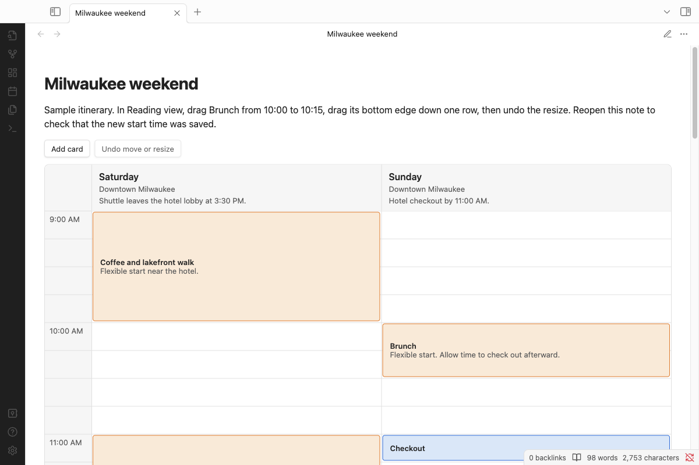
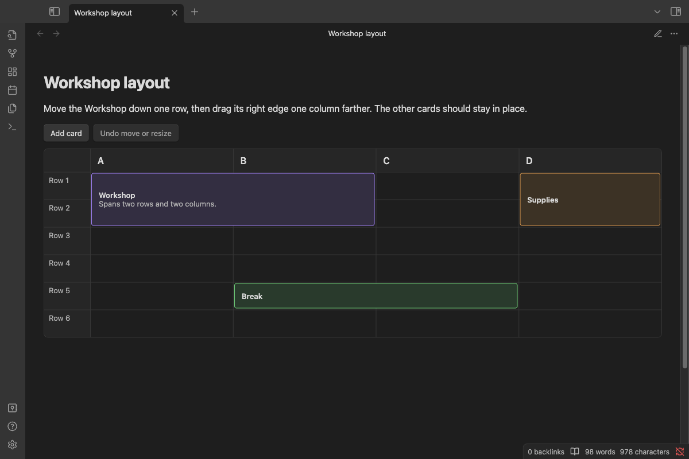
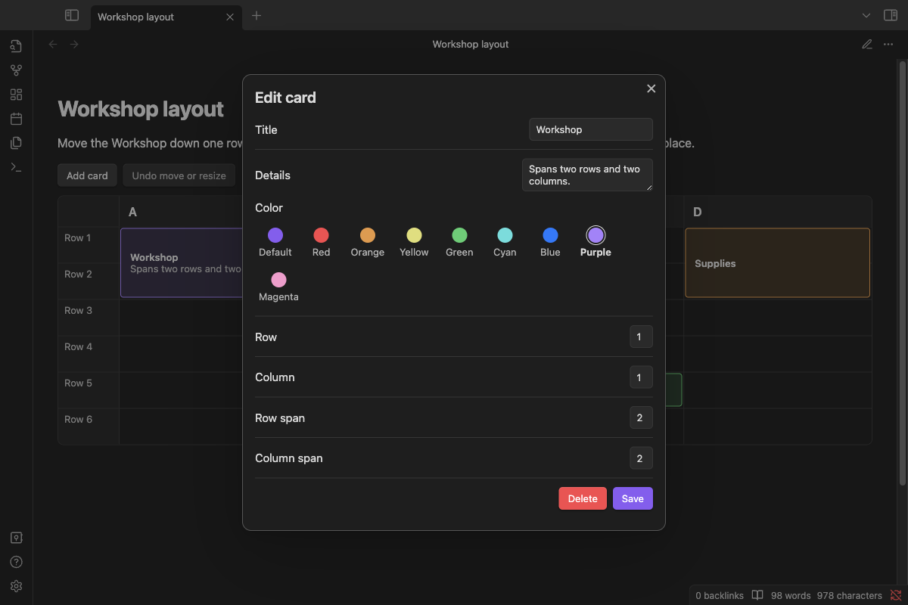

# Interactive Grid

Arrange an itinerary, schedule, seating chart, or storyboard inside an Obsidian note. Give rows and columns your own labels, add notes under column headings, and lay out colored cards across one or more cells. The grid lives in the note and works offline.



<details>
<summary>Workshop layout and card palette</summary>





</details>

## Try the demo

Run `npm ci` and `npm run demo` from the repository. Open the `test-vault` folder as a vault in Obsidian and enable Interactive Grid under **Settings → Community plugins** if prompted. Open **Milwaukee weekend** in Reading view for the sample itinerary or **Workshop layout** for a card spanning rows and columns.

For manual installation in another vault, copy the release's `main.js`, `manifest.json`, and `styles.css` into `.obsidian/plugins/interactive-grid/` and enable Interactive Grid.

## Create a grid

Paste a top-level fenced `interactive-grid` block into a note, then open Reading view or move the Live Preview cursor outside the block.

````markdown
```interactive-grid
{
  "id": "weekend",
  "rows": ["10:00", "", "10:30", ""],
  "columns": [
    { "label": "Saturday", "note": "Meet in the lobby." },
    { "label": "Sunday", "note": "Checkout by 11." }
  ],
  "cards": [
    {
      "id": "brunch",
      "title": "Brunch",
      "details": "Flexible start.",
      "color": "orange",
      "row": 1,
      "column": 2,
      "rowSpan": 2,
      "columnSpan": 1
    }
  ]
}
```
````

Use a unique grid ID per note and a unique card ID per grid. Coordinates start at 1. The row and column arrays determine the size, up to 500 rows and 50 columns. Empty row labels hide the text while retaining the row. Column notes and card details are optional plain text. The color palette includes Default (your theme accent), Red, Orange, Yellow, Green, Cyan, Blue, Purple, and Magenta. Use the lowercase name when editing the block directly.

## Upgrade grids from 1.0.0

Old `grid` blocks need conversion before Interactive Grid renders them. Open an affected note and run **Interactive Grid: Convert legacy grid blocks in current note** from the command palette. The command changes the opening fence to `interactive-grid` for blocks that match the Interactive Grid format. You can also rename the fence manually in Source mode.

## Arrange cards

- Choose **Add card** or double-click an empty cell. Click or tap a card to edit its content, color, or position.
- Drag a card body to move it. Drag any of its four edges to resize it. The outline shows the snapped position. A red outline indicates an invalid position.
- With the keyboard, tab to the card or an edge and use the arrow keys to move or resize one cell at a time. Press Enter on the card to open its editor. The position fields also work for precise edits on touchscreens.
- **Undo move or resize** restores the previous position in the current session. The button is available while the grid still matches the saved move or resize.
- Each cell can belong to one card. Invalid drops leave the card and its neighbors in place.

Edits are saved to the code block. If its source changes before a write, reopen the note and retry. Use Source mode to edit labels or other grid settings directly.

## Development

`npm run check` runs the official Obsidian ESLint rules, unit tests, TypeScript compilation, and release checks. `npm run package` stages the three release assets. See [RELEASING.md](RELEASING.md) for the desktop smoke test and publication steps.

MIT licensed. See [LICENSE](LICENSE) and [third-party notices](THIRD-PARTY-NOTICES.md).
